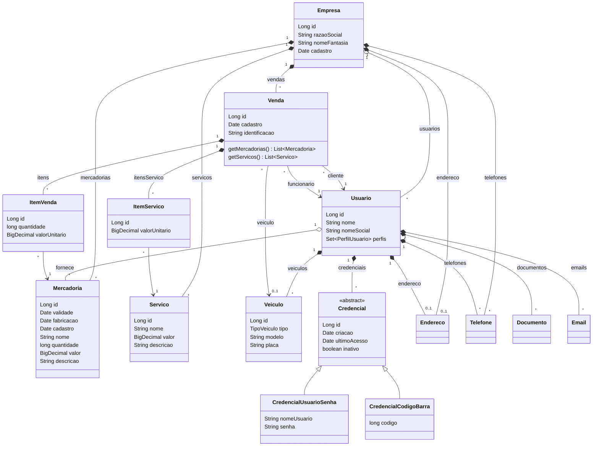

# AutoBots — Automanager (ATVIII: atualização de base)

API REST do **Automanager**, sistema de gestão da AutoBots para lojas de
manutenção veicular e venda de autopeças.

**Atividade ATVIII** — Prof. Dr. Eng. Gerson Penha

Continuação da ATVII. Nesta etapa o sistema deixou de cadastrar apenas clientes e
passou a registrar empresas, usuários, veículos, mercadorias, serviços e vendas,
com CRUD e HATEOAS em todas as entidades.

| Funcionalidade pedida | Onde está |
|---|---|
| Cadastro de empresa | [`/empresa`](#empresa) |
| Associação de usuários a uma empresa | [`/empresa/{id}/usuarios`](#empresa) |
| Tipos de usuário: cliente, fornecedor ou funcionário | campo `perfis` em [`/usuario`](#usuário) |
| Cadastro de veículos, mercadorias e serviços, para gerenciar vendas e serviços prestados a um usuário e seu veículo | [`/veiculo`](#veículo), [`/mercadoria`](#mercadoria), [`/servico`](#serviço), [`/venda`](#venda) |
| Credencial de acesso do usuário ao sistema | [`/credencial`](#credencial) |

---

## Tecnologias

| | Versão |
|---|---|
| Java | 17 |
| Spring Boot | 2.6.3 |
| Spring Data JPA / Hibernate | 5.6 |
| Spring HATEOAS | 1.4.1 |
| PostgreSQL | 16 |
| Docker Compose | — |

## O que precisa estar instalado na máquina

**Apenas o Docker Desktop** (ou Docker + Docker Compose no Linux).

Java, Maven e IDE **não** são necessários para executar. A compilação e a
execução acontecem dentro dos containers: o `Dockerfile` baixa o Maven, compila o
projeto e gera a imagem final contendo apenas o JRE e o `.jar`.

As portas `18080` (API) e `5433` (PostgreSQL) precisam estar livres.

---

## Como executar

```bash
git clone https://github.com/pedrodevroot/ATVIII.git
cd ATVIII
docker compose up -d --build
```

Nada para configurar: usuário, senha e nome do banco já estão no
`docker-compose.yml`.

| | Endereço |
|---|---|
| API | http://localhost:18080 |
| PostgreSQL | localhost:5433 — base/usuário/senha: `autobots` |

O comando sobe dois containers: o PostgreSQL e o microsserviço. Na primeira
subida, os [dados de demonstração](#dados-de-demonstração) são cadastrados
automaticamente.

> **Já executou a ATVII ou uma versão anterior desta atividade nesta máquina?**
> Todas usam o mesmo volume do banco, e o esquema antigo não é compatível com o
> modelo atual. Antes do `up`, apague esse banco e o container antigo com
> `docker compose down -v --remove-orphans`.
> O comando remove de vez os dados que estiverem nele.

### Conferir se subiu

```bash
docker compose ps
curl http://localhost:18080/usuario/usuarios
```

### Parar

```bash
docker compose down        # para os containers e mantém os dados
docker compose down -v     # para e apaga o banco
```

---

## Como executar os testes

```bash
./mvnw test          # Windows: .\mvnw.cmd test
```

São **568 testes automatizados**.

Os testes **não precisam de Docker nem de PostgreSQL** — os de integração usam
banco H2 em memória. Precisam apenas de **Java 17** ou mais recente instalado; o
Maven vem junto com o projeto, no `mvnw`.

| Camada | Testes | Ferramenta |
|---|---|---|
| Regras de domínio | 50 | JUnit 5 |
| Conversores DTO | 52 | JUnit 5 |
| Serviços | 178 | JUnit 5 + Mockito |
| Controllers (incluindo os links) | 217 | MockMvc |
| Mapeamento JPA | 29 | H2 |
| Integração ponta a ponta (incluindo a navegação pelos links) | 42 | H2 |

Para rodar os testes sem instalar Java, dentro de um container:

```bash
docker run --rm -v "${PWD}:/src:ro" maven:3.8.4-eclipse-temurin-17 sh -c "mkdir /app && cp -r /src/pom.xml /src/src /app && cd /app && mvn test"
```

O comando compila uma cópia do código dentro do container e não toca na pasta
`target`, então pode ser usado com a IDE aberta.

---

## Modelo de dados

As classes seguem o diagrama da Figura 1 do enunciado.

| Entidade | O que representa | Ligações |
|---|---|---|
| `Empresa` | Unidade comercial que oferece os serviços e vende as mercadorias | endereço, telefones, usuários, mercadorias, serviços e vendas |
| `Usuario` | Cliente, fornecedor ou funcionário (`perfis`) | empresa, endereço, telefones, documentos, e-mails, credenciais, veículos, mercadorias fornecidas e vendas |
| `Credencial` | Acesso ao sistema: `CredencialUsuarioSenha` ou `CredencialCodigoBarra` | usuário |
| `Veiculo` | Carro de um usuário: tipo, modelo e placa | proprietário e vendas |
| `Mercadoria` | Peça ou produto: validade, fabricação, quantidade e valor | empresa e fornecedor |
| `Servico` | Trabalho oferecido pela oficina: nome, valor e descrição | empresa |
| `Venda` | Registro do que foi vendido a um cliente | cliente, funcionário, veículo (opcional), itens e serviços |
| `ItemVenda` | Quantas unidades de uma mercadoria entraram em uma venda e por qual valor | venda e mercadoria |
| `ItemServico` | Por qual valor um serviço entrou em uma venda | venda e serviço |

| Enumeração | Valores |
|---|---|
| `PerfilUsuario` | `CLIENTE`, `FUNCIONARIO`, `FORNECEDOR` |
| `TipoDocumento` | `CPF`, `CNPJ`, `RG`, `CNH`, `PASSAPORTE` |
| `TipoVeiculo` | `HATCH`, `SEDA`, `SUV`, `PICKUP`, `SW` |

O diagrama abaixo é a Figura 1 do enunciado com dois acréscimos: `ItemVenda` e
`ItemServico`. Com as listas diretas da Figura 1, a venda não registra quantas unidades
de cada mercadoria foram vendidas nem por qual valor, informações necessárias para
controlar o estoque e manter o histórico. As listas de mercadorias e serviços da Figura 1
continuam disponíveis em `Venda.getMercadorias()` e `Venda.getServicos()`.



---

## Níveis de maturidade (RMM)

O modelo de maturidade de Richardson mede o quanto uma API segue o estilo REST.
Cada nível inclui o anterior.

| Nível | Significado | Como a API atende |
|---|---|---|
| **0** — Uso do protocolo HTTP | A comunicação acontece por HTTP | Toda a API é exposta por HTTP em `http://localhost:18080` |
| **1** — URI única por recurso | Cada recurso tem o seu próprio endereço | `/usuario/{id}`, `/empresa/{id}`, `/veiculo/{id}`, `/venda/{id}` e as coleções `/usuario/{id}/veiculos`, `/empresa/{id}/vendas` |
| **2** — Uso dos métodos e suas semânticas | O método HTTP diz a ação e o status diz o resultado | `GET` lê, `POST` cria, `PUT` atualiza, `DELETE` remove; respostas `200`, `201` + `Location`, `204`, `400`, `404` e `409` |
| **3** — HATEOAS | A resposta traz os links para os próximos passos | Toda resposta com corpo traz links gerados pelo Spring HATEOAS |

### Nível 3: HATEOAS

`GET http://localhost:18080/venda/1` (trecho da resposta):

```json
{
  "id": 1,
  "identificacao": "1234698745",
  "clienteId": 3,
  "funcionarioId": 1,
  "veiculoId": 1,
  "valorTotal": 1300.00,
  "itens": [
    {
      "id": 1,
      "mercadoriaId": 1,
      "nome": "Roda de liga leve modelo toyota etios",
      "quantidade": 4,
      "valorUnitario": 300.00,
      "_links": { "mercadoria": { "href": "http://localhost:18080/mercadoria/1" } }
    }
  ],
  "_links": {
    "self":        { "href": "http://localhost:18080/venda/1" },
    "cliente":     { "href": "http://localhost:18080/usuario/3" },
    "funcionario": { "href": "http://localhost:18080/usuario/1" },
    "veiculo":     { "href": "http://localhost:18080/veiculo/1" }
  }
}
```

| Resposta | Links |
|---|---|
| Uma empresa | `self`, `empresas`, `usuarios`, `telefones`, `mercadorias`, `servicos`, `vendas` e, se houver, `endereco` |
| Um usuário | `self`, `usuarios`, `telefones`, `documentos`, `emails`, `credenciais`, `veiculos`, `mercadorias`, `vendas` e, se houver, `endereco` e `empresa` |
| Um veículo | `self`, `proprietario`, `vendas` |
| Uma venda | `self`, `cliente`, `funcionario` e, se houver, `veiculo`; `mercadoria` em cada item e `self` em cada serviço |
| Uma mercadoria, serviço, telefone, documento, e-mail, endereço ou credencial | `self` |
| Qualquer lista | `self` em cada item |
| `PUT` de vínculo, `DELETE` (204) e respostas de erro | sem links |

Nas listas o Spring representa os links de cada item como
`"links": [ { "rel": "self", "href": "..." } ]`; num objeto único, como
`"_links": { "self": { "href": "..." } }` (formato HAL).

Com isso, um cliente da API precisa conhecer apenas o primeiro endereço. A partir
de `GET /empresa/empresas` ele chega à empresa, às vendas dela, ao veículo da
venda e ao proprietário do veículo sem montar nenhuma URL. O teste
`navegacaoAteAVenda` do `IntegracaoVendaTest` faz exatamente esse caminho.

**Como foi implementado:**

| Parte | Arquivo |
|---|---|
| Dependência `spring-boot-starter-hateoas` | `pom.xml` |
| DTOs de resposta estendem `RepresentationModel` | `VendaRespostaDto`, `VeiculoDto`, `MercadoriaDto`, `ServicoDto` e os demais |
| Contrato dos adicionadores de link | `modelo/AdicionadorLink` |
| Montagem dos links com `WebMvcLinkBuilder` (`linkTo` + `methodOn`) | `modelo/AdicionadorLink*` |
| Links adicionados antes de cada resposta | os controllers |

Os links são construídos a partir dos métodos dos controllers, e não de textos
fixos: se uma rota mudar, o link muda junto.

### Escolhas de status no nível 2

O código de apoio das atividades usa outros status em alguns casos. Aqui a escolha
foi seguir a semântica do HTTP:

| Situação | Código de apoio | Esta API | Motivo |
|---|---|---|---|
| `GET` com sucesso | `302 Found` | `200 OK` | `302` indica redirecionamento para outro endereço, não sucesso |
| Lista vazia | `404 Not Found` | `200 OK` com `[]` | A coleção existe; ela só não tem itens |
| `DELETE` com sucesso | `200 OK`, id no corpo da requisição | `204 No Content`, id na URL | Não há conteúdo a devolver, e o recurso é identificado pela URI |

---

## Dados de demonstração

Cadastrados automaticamente quando o banco está vazio:

| Recurso | Ids |
|---|---|
| Empresa | `1` — Car service toyota ltda |
| Usuários | `1` funcionário, `2` fornecedor, `3` cliente, todos vinculados à empresa `1` |
| Veículo | `1` — Corolla Cross, placa `ABC0000`, do cliente `3` |
| Mercadoria | `1` — roda de liga leve, fornecida pelo usuário `2`, com 22 unidades em estoque |
| Serviços | `1` troca de rodas, `2` alinhamento, `3` balanceamento |
| Vendas | `1` e `2` — cliente `3`, funcionário `1`, veículo `1`, com 4 rodas cada |
| Credenciais | `1` `dompedrofuncionario`, `2` `dompedrofornecedor`, `3` `dompedrocliente`, todas com a senha `123456` |
| Documentos | `1`, `2`, `3` — um para cada usuário, na mesma ordem |
| E-mails | `1`, `2`, `3` — um para cada usuário, na mesma ordem |
| Endereços | `1`, `2`, `3` dos usuários, na mesma ordem, e `4` da empresa |
| Telefones | `1` do usuário `1` e `2` da empresa |

---

## Endpoints

Base: `http://localhost:18080`

Em todo `POST` e `PUT` com corpo, o conteúdo é JSON
(`Content-Type: application/json`).

As tabelas abaixo podem ser executadas de cima para baixo em um banco recém-criado.
Os `id` nas URLs valem para essa ordem. Cada `POST` devolve o `id` gerado no corpo
da resposta e no header `Location` — em outra ordem, é esse valor que deve ser usado.

### Usuário

| Método | URL | Corpo | Esperado |
|---|---|---|---|
| `GET` | `/usuario/usuarios` | — | 200 |
| `GET` | `/usuario/3` | — | 200 |
| `POST` | `/usuario/cadastro` | **A** | 201 |
| `POST` | `/usuario/cadastro` | **B** | 201 |
| `PUT` | `/usuario/atualizar` | **C** | 200 |
| `DELETE` | `/usuario/excluir/4` | — | 204 |

### Empresa

| Método | URL | Corpo | Esperado |
|---|---|---|---|
| `GET` | `/empresa/empresas` | — | 200 |
| `GET` | `/empresa/1` | — | 200 |
| `POST` | `/empresa/cadastro` | **D** | 201 |
| `PUT` | `/empresa/atualizar` | **E** | 200 |
| `GET` | `/empresa/1/usuarios` | — | 200 |
| `PUT` | `/empresa/2/usuarios/5` | — | 204 |
| `GET` | `/empresa/2/usuarios` | — | 200 |
| `DELETE` | `/empresa/2/usuarios/5` | — | 204 |
| `DELETE` | `/empresa/excluir/2` | — | 204 |

Um usuário fica vinculado a uma empresa por vez. A exclusão da empresa apaga as
vendas, mercadorias e serviços dela e mantém os usuários, sem vínculo.

### Veículo

| Método | URL | Corpo | Esperado |
|---|---|---|---|
| `GET` | `/usuario/3/veiculos` | — | 200 |
| `POST` | `/usuario/3/veiculos` | **L** | 201 |
| `GET` | `/veiculo/2` | — | 200 |
| `PUT` | `/veiculo/2` | `{ "modelo": "Etios X" }` | 200 |
| `DELETE` | `/veiculo/2` | — | 204 |

### Mercadoria

| Método | URL | Corpo | Esperado |
|---|---|---|---|
| `GET` | `/empresa/1/mercadorias` | — | 200 |
| `POST` | `/empresa/1/mercadorias` | **M** | 201 |
| `GET` | `/mercadoria/2` | — | 200 |
| `PUT` | `/mercadoria/2` | `{ "quantidade": 8 }` | 200 |
| `GET` | `/usuario/2/mercadorias` | — | 200 |
| `PUT` | `/usuario/2/mercadorias/2` | — | 204 |
| `DELETE` | `/usuario/2/mercadorias/2` | — | 204 |
| `DELETE` | `/mercadoria/2` | — | 204 |

`/usuario/{id}/mercadorias` são as mercadorias fornecidas por aquele usuário. O
`PUT` vincula o fornecedor à mercadoria, e o `DELETE` desfaz o vínculo sem apagar
a mercadoria.

### Serviço

| Método | URL | Corpo | Esperado |
|---|---|---|---|
| `GET` | `/empresa/1/servicos` | — | 200 |
| `POST` | `/empresa/1/servicos` | **N** | 201 |
| `GET` | `/servico/4` | — | 200 |
| `PUT` | `/servico/4` | `{ "valor": 250.00 }` | 200 |
| `DELETE` | `/servico/4` | — | 204 |

### Venda

| Método | URL | Corpo | Esperado |
|---|---|---|---|
| `GET` | `/empresa/1/vendas` | — | 200 |
| `GET` | `/usuario/3/vendas` | — | 200 |
| `GET` | `/veiculo/1/vendas` | — | 200 |
| `POST` | `/empresa/1/vendas` | **O** | 201 |
| `GET` | `/venda/3` | — | 200 |
| `PUT` | `/venda/3` | **P** | 200 |
| `PUT` | `/venda/3` | `{ "removerVeiculo": true }` | 200 |
| `DELETE` | `/venda/3` | — | 204 |

`/usuario/{id}/vendas` traz as vendas em que o usuário é o cliente ou o funcionário.

A mercadoria entra na venda pelo campo `itens`, com a quantidade de cada uma, e o
serviço pelo campo `servicoIds`. O valor de cada um é o do momento em que entrou na
venda e não muda se o preço for alterado depois. A resposta traz o `valorTotal`, com
a soma das mercadorias, multiplicadas pela quantidade, e dos serviços.

| Operação | Efeito no estoque da mercadoria |
|---|---|
| `POST` | Desconta a quantidade de cada item. Se alguma mercadoria não tiver o suficiente, responde 409 e nada é descontado |
| `PUT` com `itens` | Devolve as quantidades antigas e desconta as novas. Se não houver o suficiente, responde 409 e nada muda |
| `PUT` sem `itens` | Não mexe no estoque |
| `DELETE` | Devolve as quantidades |
| Exclusão da empresa | Apaga as vendas junto com as mercadorias |

No `PUT`, só os campos enviados são alterados. Uma lista enviada substitui a
anterior, e uma lista vazia remove os itens, desde que a venda continue com ao
menos uma mercadoria ou um serviço.

### Telefone

| Método | URL | Corpo | Esperado |
|---|---|---|---|
| `GET` | `/usuario/1/telefones` | — | 200 |
| `POST` | `/usuario/1/telefones` | **F** | 201 |
| `GET` | `/empresa/1/telefones` | — | 200 |
| `POST` | `/empresa/1/telefones` | **F** | 201 |
| `GET` | `/telefone/1` | — | 200 |
| `PUT` | `/telefone/1` | `{ "ddd": "12" }` | 200 |
| `DELETE` | `/telefone/1` | — | 204 |

### Documento

| Método | URL | Corpo | Esperado |
|---|---|---|---|
| `GET` | `/usuario/1/documentos` | — | 200 |
| `POST` | `/usuario/1/documentos` | **G** | 201 |
| `GET` | `/documento/1` | — | 200 |
| `PUT` | `/documento/1` | `{ "tipo": "RG" }` | 200 |
| `DELETE` | `/documento/1` | — | 204 |

### E-mail

| Método | URL | Corpo | Esperado |
|---|---|---|---|
| `GET` | `/usuario/1/emails` | — | 200 |
| `POST` | `/usuario/1/emails` | **H** | 201 |
| `GET` | `/email/1` | — | 200 |
| `PUT` | `/email/1` | `{ "endereco": "novo@email.com" }` | 200 |
| `DELETE` | `/email/1` | — | 204 |

### Credencial

| Método | URL | Corpo | Esperado |
|---|---|---|---|
| `GET` | `/usuario/1/credenciais` | — | 200 |
| `POST` | `/usuario/1/credenciais` | **I** | 201 |
| `POST` | `/usuario/1/credenciais` | **J** | 201 |
| `GET` | `/credencial/1` | — | 200 |
| `PUT` | `/credencial/1` | `{ "inativo": true }` | 200 |
| `DELETE` | `/credencial/1` | — | 204 |

O tipo é informado no campo `tipo`: `USUARIO_SENHA` ou `CODIGO_BARRA`. A senha
nunca aparece nas respostas.

### Endereço

Um usuário ou uma empresa tem **um** endereço.

| Método | URL | Corpo | Esperado |
|---|---|---|---|
| `GET` | `/usuario/1/endereco` | — | 200 |
| `GET` | `/empresa/1/endereco` | — | 200 |
| `GET` | `/endereco/1` | — | 200 |
| `PUT` | `/endereco/1` | `{ "cidade": "Santos" }` | 200 |
| `DELETE` | `/endereco/1` | — | 204 |
| `POST` | `/usuario/1/endereco` | **K** | 201 |
| `DELETE` | `/endereco/4` | — | 204 |
| `POST` | `/empresa/1/endereco` | **K** | 201 |
| `DELETE` | `/endereco/5` | — | 204 |

### Corpos

**A** — usuário simples
```json
{ "nome": "Maria Silva", "perfis": [ "CLIENTE" ] }
```

**B** — usuário completo
```json
{
  "nome": "Joana Ferreira de Souza",
  "nomeSocial": "Joana",
  "dataNascimento": "1995-08-20T00:00:00.000+00:00",
  "perfis": [ "CLIENTE" ],
  "endereco": {
    "estado": "Sao Paulo", "cidade": "Santos", "bairro": "Gonzaga",
    "rua": "Avenida Ana Costa", "numero": "250",
    "codigoPostal": "11060002", "informacoesAdicionais": "Apartamento 32"
  },
  "documentos": [
    { "tipo": "RG", "dataEmissao": "2015-03-10T00:00:00.000+00:00", "numero": "998877" },
    { "tipo": "CPF", "dataEmissao": "2010-05-20T00:00:00.000+00:00", "numero": "12345678901" }
  ],
  "telefones": [ { "ddd": "13", "numero": "981234567" } ],
  "emails": [ { "endereco": "joana@email.com" } ],
  "credenciais": [
    { "tipo": "USUARIO_SENHA", "nomeUsuario": "joana", "senha": "segredo1" },
    { "tipo": "CODIGO_BARRA", "codigo": 7891234 }
  ]
}
```

**C** — atualização parcial do usuário: só os campos enviados são alterados. Para
alterar um filho, o `id` dele é obrigatório e ele precisa pertencer ao usuário.
```json
{
  "id": 3,
  "nomeSocial": "Dom Pedro I",
  "endereco": { "codigoPostal": "11015200" },
  "emails": [ { "id": 3, "endereco": "dompedro@email.com" } ]
}
```

**D** — empresa
```json
{
  "razaoSocial": "Volkswagen Servicos Ltda",
  "nomeFantasia": "VW Servicos",
  "endereco": { "cidade": "Santos", "rua": "Avenida Ana Costa", "numero": "100" },
  "telefones": [ { "ddd": "13", "numero": "32221100" } ]
}
```

**E** — atualização parcial da empresa
```json
{ "id": 2, "nomeFantasia": "VW Santos" }
```

**F** — telefone
```json
{ "ddd": "13", "numero": "988887777" }
```

**G** — documento
```json
{ "tipo": "CNH", "dataEmissao": "2020-01-15T00:00:00.000+00:00", "numero": "55443322" }
```

**H** — e-mail
```json
{ "endereco": "maria@email.com" }
```

**I** — credencial de usuário e senha
```json
{ "tipo": "USUARIO_SENHA", "nomeUsuario": "maria", "senha": "segredo1" }
```

**J** — credencial de código de barras
```json
{ "tipo": "CODIGO_BARRA", "codigo": 123456789 }
```

**K** — endereço
```json
{
  "estado": "Sao Paulo", "cidade": "Santos", "bairro": "Gonzaga",
  "rua": "Avenida Ana Costa", "numero": "250", "codigoPostal": "11060002"
}
```

**L** — veículo
```json
{ "tipo": "HATCH", "modelo": "Etios", "placa": "XYZ1A23" }
```

**M** — mercadoria
```json
{
  "nome": "Oleo de motor",
  "descricao": "Oleo sintetico 5W30",
  "fabricacao": "2025-03-01T00:00:00.000+00:00",
  "validade": "2027-03-01T00:00:00.000+00:00",
  "quantidade": 5,
  "valor": 49.90
}
```

**N** — serviço
```json
{ "nome": "Revisao", "descricao": "Revisao completa", "valor": 200.00 }
```

**O** — venda
```json
{
  "identificacao": "OS-0001",
  "clienteId": 3,
  "funcionarioId": 1,
  "veiculoId": 1,
  "itens": [ { "mercadoriaId": 1, "quantidade": 2 } ],
  "servicoIds": [ 1, 2 ]
}
```

**P** — atualização parcial da venda
```json
{
  "identificacao": "OS-0002",
  "itens": [ { "mercadoriaId": 1, "quantidade": 3 } ],
  "servicoIds": [ 3 ]
}
```

### Casos de erro

Executados depois das tabelas acima.

| Método | URL | Corpo | Esperado |
|---|---|---|---|
| `GET` | `/usuario/999` | — | 404 |
| `GET` | `/empresa/999` | — | 404 |
| `GET` | `/veiculo/999` | — | 404 |
| `GET` | `/mercadoria/999` | — | 404 |
| `GET` | `/servico/999` | — | 404 |
| `GET` | `/venda/999` | — | 404 |
| `DELETE` | `/usuario/excluir/999` | — | 404 |
| `POST` | `/usuario/999/veiculos` | **L** | 404 |
| `POST` | `/empresa/999/vendas` | **O** | 404 |
| `PUT` | `/usuario/atualizar` | `{ "id": 5, "endereco": { "cidade": "Santos" } }` | 404 |
| `PUT` | `/usuario/atualizar` | `{ "id": 3, "emails": [ { "id": 2, "endereco": "x@email.com" } ] }` | 404 |
| `PUT` | `/empresa/atualizar` | `{ "id": 1, "telefones": [ { "id": 99, "ddd": "12" } ] }` | 404 |
| `POST` | `/usuario/cadastro` | `{ "nomeSocial": "Sem nome" }` | 400 |
| `POST` | `/usuario/cadastro` | `{ "nome": "Sem perfil" }` | 400 |
| `POST` | `/usuario/cadastro` | `{ "nome": "X", "perfis": [ "GERENTE" ] }` | 400 |
| `POST` | `/usuario/cadastro` | **Q** | 400 |
| `PUT` | `/usuario/atualizar` | `{ "nome": "Sem id" }` | 400 |
| `PUT` | `/usuario/atualizar` | `{ "id": 3, "perfis": [ null ] }` | 400 |
| `POST` | `/usuario/cadastro` | `{ "nome": "X", "perfis": [ "CLIENTE" ], "telefones": [ null ] }` | 400 |
| `POST` | `/usuario/cadastro` | `{ "nome": "X", "perfis": [ 0 ] }` | 400 |
| `POST` | `/empresa/cadastro` | `{ "nomeFantasia": "Sem razao social" }` | 400 |
| `POST` | `/usuario/3/veiculos` | `{ "tipo": "SUV", "modelo": "Yaris", "placa": "abc" }` | 400 |
| `POST` | `/usuario/3/veiculos` | `{ "tipo": "AVIAO", "modelo": "Yaris", "placa": "XYZ1234" }` | 400 |
| `POST` | `/usuario/3/veiculos` | `{ "tipo": 0, "modelo": "Yaris", "placa": "XYZ1234" }` | 400 |
| `POST` | `/empresa/1/mercadorias` | **R** | 400 |
| `POST` | `/empresa/1/mercadorias` | `{ "nome": "Oleo", "fabricacao": "2025-03-01T00:00:00.000+00:00", "quantidade": 1000000000, "valor": 1 }` | 400 |
| `POST` | `/empresa/1/servicos` | `{ "nome": "Negativo", "valor": -1 }` | 400 |
| `PUT` | `/usuario/3/mercadorias/1` | — | 400 |
| `POST` | `/empresa/1/vendas` | **S** | 400 |
| `POST` | `/empresa/1/vendas` | **T** | 400 |
| `POST` | `/empresa/1/vendas` | **U** | 400 |
| `POST` | `/empresa/1/vendas` | **V** | 400 |
| `POST` | `/empresa/1/vendas` | **W** | 400 |
| `POST` | `/empresa/1/vendas` | `{ "identificacao": "E-6", "clienteId": 3, "funcionarioId": 1, "itens": [ { "mercadoriaId": 1, "quantidade": 1 }, { "mercadoriaId": 1, "quantidade": 2 } ] }` | 400 |
| `POST` | `/empresa/1/vendas` | `{ "identificacao": "E-7", "clienteId": 3, "funcionarioId": 1, "itens": [ { "mercadoriaId": 1, "quantidade": 0 } ] }` | 400 |
| `POST` | `/empresa/1/vendas` | `{ "identificacao": "E-8", "clienteId": 3, "funcionarioId": 1, "itens": [ { "mercadoriaId": 1, "quantidade": 9999 } ] }` | 409 |
| `PUT` | `/venda/1` | `{ "veiculoId": 1, "removerVeiculo": true }` | 400 |
| `PUT` | `/usuario/atualizar` | `{ "id": 3, "perfis": [ "FORNECEDOR" ] }` | 409 |
| `POST` | `/usuario/cadastro` | **X** | 409 |
| `POST` | `/usuario/3/veiculos` | `{ "tipo": "SUV", "modelo": "Yaris", "placa": "ABC0000" }` | 409 |
| `POST` | `/usuario/1/endereco` | **K** | 409 |
| `POST` | `/empresa/1/vendas` | **Y** | 409 |
| `DELETE` | `/usuario/excluir/3` | — | 409 |
| `DELETE` | `/veiculo/1` | — | 409 |
| `DELETE` | `/mercadoria/1` | — | 409 |
| `DELETE` | `/servico/1` | — | 409 |

**Q** — vários campos inválidos ao mesmo tempo
```json
{
  "nome": "Invalido",
  "perfis": [ "CLIENTE" ],
  "telefones": [ { "ddd": "1", "numero": "abc" } ],
  "endereco": { "bairro": "Centro" },
  "emails": [ { "endereco": "sem arroba" } ]
}
```

**R** — validade anterior à fabricação
```json
{
  "nome": "Oleo",
  "fabricacao": "2025-03-01T00:00:00.000+00:00",
  "validade": "2020-03-01T00:00:00.000+00:00",
  "quantidade": 5,
  "valor": 49.90
}
```

**S** — o usuário `1` é funcionário, não cliente
```json
{ "identificacao": "E-1", "clienteId": 1, "funcionarioId": 1, "servicoIds": [ 1 ] }
```

**T** — o usuário `3` é cliente, não funcionário
```json
{ "identificacao": "E-2", "clienteId": 3, "funcionarioId": 3, "servicoIds": [ 1 ] }
```

**U** — o veículo `1` não é do cliente `5`
```json
{ "identificacao": "E-3", "clienteId": 5, "funcionarioId": 1, "veiculoId": 1, "servicoIds": [ 1 ] }
```

**V** — venda sem nenhum item
```json
{ "identificacao": "E-4", "clienteId": 3, "funcionarioId": 1 }
```

**W** — o mesmo item repetido
```json
{ "identificacao": "E-5", "clienteId": 3, "funcionarioId": 1, "servicoIds": [ 1, 1 ] }
```

**X** — número de documento duplicado (o CPF `12584698533` já pertence ao usuário `3`)
```json
{
  "nome": "Documento Repetido",
  "perfis": [ "CLIENTE" ],
  "documentos": [
    { "tipo": "CPF", "dataEmissao": "2010-05-20T00:00:00.000+00:00", "numero": "12584698533" }
  ]
}
```

**Y** — identificação de venda duplicada
```json
{ "identificacao": "1234698745", "clienteId": 3, "funcionarioId": 1, "servicoIds": [ 1 ] }
```

### Respostas de erro

```json
{
  "momento": "2026-11-01T18:01:30.026",
  "status": 400,
  "erro": "Bad Request",
  "mensagem": "O veiculo de id 1 nao pertence ao cliente de id 5",
  "caminho": "/empresa/1/vendas"
}
```

Erros de validação acrescentam a lista de campos, todos de uma vez:

```json
{
  "status": 400,
  "mensagem": "Os dados enviados nao passaram na validacao.",
  "erros": [
    { "campo": "telefones[0].ddd", "mensagem": "O DDD deve conter exatamente 2 digitos" },
    { "campo": "endereco.cidade", "mensagem": "A cidade e obrigatoria" }
  ]
}
```

### Validações e regras

| Campo ou operação | Regra |
|---|---|
| `usuario.nome` · `perfis` | obrigatórios no cadastro; ao menos um perfil |
| `usuario.dataNascimento` | se informada, deve estar no passado |
| `empresa.razaoSocial` | obrigatória no cadastro |
| `documento.tipo` · `dataEmissao` · `numero` | obrigatórios; a emissão não pode estar no futuro; `numero` é único no sistema |
| `telefone.ddd` | 2 dígitos |
| `telefone.numero` | 8 ou 9 dígitos |
| `email.endereco` | obrigatório, em formato de e-mail |
| `endereco.cidade` · `rua` · `numero` | obrigatórios |
| `endereco.codigoPostal` | se informado, 8 dígitos |
| `credencial.nomeUsuario` · `senha` | obrigatórios; `nomeUsuario` é único; senha de 6 a 255 caracteres |
| `credencial.codigo` | obrigatório, positivo e único |
| `veiculo.tipo` · `modelo` · `placa` | obrigatórios; placa única, no formato `ABC1234` ou `ABC1D23` |
| `mercadoria.nome` · `fabricacao` · `quantidade` · `valor` | obrigatórios; fabricação não pode estar no futuro; quantidade e valor não podem ser negativos; quantidade de até 999999999 |
| `mercadoria.validade` | opcional; não pode ser anterior à fabricação |
| `servico.nome` · `valor` | obrigatórios; o valor não pode ser negativo |
| `valor` de mercadoria e serviço | até 8 dígitos inteiros e 2 decimais |
| `venda.identificacao` · `clienteId` · `funcionarioId` | obrigatórios; a identificação é única |
| Cliente da venda | deve ter o perfil `CLIENTE`; se estiver vinculado a uma empresa, deve ser a da venda |
| Funcionário da venda | deve ter o perfil `FUNCIONARIO` e estar vinculado à empresa da venda |
| Veículo da venda | opcional; deve pertencer ao cliente da venda |
| Conteúdo da venda | ao menos uma mercadoria ou um serviço, sem repetição, todos da empresa da venda |
| `itens[].mercadoriaId` · `quantidade` | obrigatórios; a quantidade deve ser maior que zero e não pode superar o estoque |
| Fornecedor da mercadoria | deve ter o perfil `FORNECEDOR`; a mercadoria tem um fornecedor por vez |
| `PUT` de usuário e empresa | `endereco` exige que já exista um (para criar, use o `POST`); cada filho enviado precisa pertencer ao usuário ou à empresa |
| Exclusão de veículo, mercadoria ou serviço | recusada se aparecer em alguma venda |
| Retirada de perfil | `CLIENTE` e `FUNCIONARIO` não saem de quem tem vendas nesse papel; `FORNECEDOR` não sai de quem fornece mercadorias |
| Veículo no `PUT` de venda | `veiculoId` troca e `removerVeiculo: true` remove; os dois juntos são recusados |
| `mercadoria.quantidade` | estoque atual: muda com as vendas e pode ser reposto com `PUT /mercadoria/{id}` |
| Vendas simultâneas | o desconto é feito pelo banco, então duas vendas não levam a mesma unidade |
| Requisições simultâneas em conflito | a que perder a disputa responde 409 e pode ser repetida |
| Exclusão de usuário | recusada se for cliente ou funcionário em alguma venda |
| `dataCadastro` · `cadastro` · `criacao` | definidos pelo servidor, não aceitos na entrada |
| Listas nos corpos | `null` dentro de uma lista é recusado; a lista inteira como `null` vale como vazia, e no `PUT /venda/{id}` vale como não enviada |
| Tipos e perfis | aceitos somente pelo nome, nunca por número |

---

## Alterações da ATVIII

| O que mudou | Onde |
|---|---|
| Classes do novo modelo de dados e enumerações | `entidades`, `enumeracoes` |
| `Cliente` substituído por `Usuario`, com perfis, e-mails e credenciais | `UsuarioControle`, `UsuarioServico`, `EmailControle`, `CredencialControle` |
| CRUD de empresa e vínculo de usuários | `EmpresaControle`, `EmpresaServico` |
| CRUD de veículo | `VeiculoControle`, `VeiculoServico` |
| CRUD de mercadoria e vínculo com o fornecedor | `MercadoriaControle`, `MercadoriaServico` |
| CRUD de serviço | `ServicoControle`, `ServicoServico` |
| CRUD de venda, com as regras de negócio | `VendaControle`, `VendaServico` |
| Quantidade por item da venda, controle de estoque e histórico de preços | `ItemVenda`, `ItemServico`, `VendaServico`, `MercadoriaRepositorio` |
| Links para os novos recursos | `modelo/AdicionadorLink*` |
| Dados de demonstração das novas entidades | `CargaInicial` |
| Testes de todas as camadas | `src/test` |
